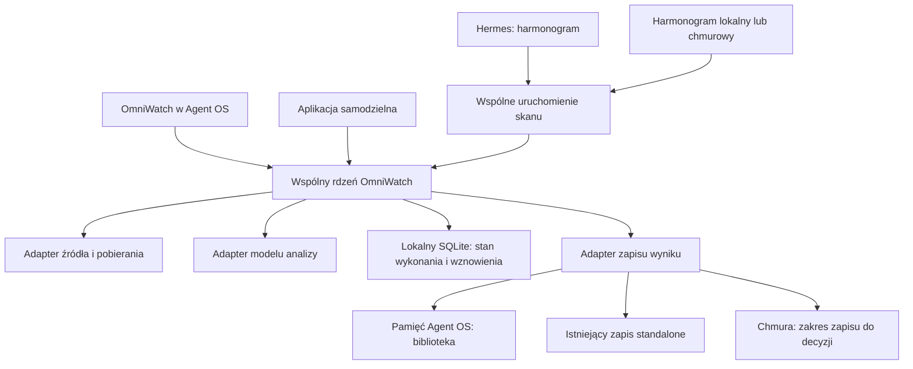

# OmniWatch — specyfikacja produktu v0.1

Data: 2026-09-22. Status: **wersja do przeglądu**, opracowana z ustaleń użytkownika,
wiki i odczytu istniejącego kodu. Decyzje produktowe z rozmowy są zapisane poniżej;
propozycje techniczne i nierozstrzygnięte elementy są wyraźnie oznaczone.
Plan realizacji: [PLAN.md](PLAN.md).

## 1. Cel

**Podstawowy scenariusz:** „Mam 30-minutowy film, nie chcę go oglądać. Wklejam
link, czytam streszczenie i kończę”. Jeden film i jedno użycie wystarczają do
uzyskania wartości; kanał, biblioteka i harmonogram nie są obowiązkowym początkiem.

**OmniWatch pozwala zdobywać wiedzę z filmów i być na bieżąco bez oglądania każdego
materiału samodzielnie.** Analizuje obraz i dźwięk, zachowując możliwość sprawdzenia
wniosków w konkretnym filmie i jego fragmencie.

Zastosowania są prywatne i zawodowe: nauka, zainteresowania, śledzenie branży,
analiza sposobu wykonania filmu. Research konkurencji jest jednym z zastosowań,
a popularność filmu nie definiuje jego wartości dla użytkownika.

Samodzielny OmniWatch **jest już wydany**. Teraz priorytetem jest rozwinięta wersja
dla społeczności korzystającej z Agent OS. Równolegle trzeba zaplanować współdzielenie
kodu z istniejącą aplikacją, a nie traktować jej jak nowego produktu do zbudowania.
Docelowe formy dystrybucji: samodzielna aplikacja MIT na GitHubie, integracja Agent OS
i płatny hosting dla osób, które nie chcą instalować i utrzymywać narzędzia.
Wspólny rdzeń nie oznacza identycznego zakresu funkcji w każdej formie dostarczenia.

## 2. Granice produktu — uzgodnione

| Element | Rola |
|---|---|
| OmniWatch | Analiza filmu, wielu filmów lub kanału według potrzeby użytkownika |
| Scout | Ta sama operacja uruchamiana cyklicznie; w Agent OS harmonogram zapewnia Hermes |
| Integracja z Astrosem | Link przekazujący film do OmniWatcha; bez osobnego silnika analizy |
| Integracja z pamięcią Agent OS | Biblioteka osobnych analiz jest w pamięci Agent OS; adapter korzysta z niej, zamiast zakładać drugą bazę wiedzy |
| Wersja samodzielna | Już wydana aplikacja do analizy filmów; zachowujemy działanie i migrujemy wspólną logikę |
| Hosting płatny | Przyszła usługa; zakres analizy wielu filmów, trwałej pamięci i eksportu pozostaje otwarty |

**Tworzenie nowych filmów na podstawie formatów jest drugim projektem i pozostaje
odłożone.** Analiza sposobu montażu należy do OmniWatcha. Generowanie nowego scenariusza,
assetów, awatara, klonowanie kompozycji i renderowanie nowego filmu nie należą do tego wydania.

Nie dodajemy obowiązku korzystania z Hermesa, Vaulta ani konta w naszej chmurze do
samodzielnie zainstalowanego OmniWatcha. Powłoki mogą wyglądać inaczej; znaczenie
analizy, aktualizacji i wyników ma być wspólne.

## 3. Scenariusze użytkownika

### 0. Jeden film zamiast pół godziny oglądania

Użytkownik wkleja URL; domyślnie otrzymuje streszczenie. Może opcjonalnie wskazać
temat, na którym streszczenie ma się skupić, lub zadać własne pytanie. Czyta
wynik, może sprawdzić wskazany fragment lub dopytać o film. Nie musi tworzyć
kolekcji, wybierać kanału, ustawiać harmonogramu ani budować biblioteki. To podstawowa
wartość już wydanej aplikacji i proponowany punkt wyjścia usługi chmurowej.

### Tryby i dalsza rozmowa — funkcje do zachowania

**Streszczenie jest domyślne.** Sam link wystarcza. Użytkownik może dodatkowo
ukierunkować streszczenie na interesujący go temat, np. „z tego filmu wyciągnij
informacje o redukcji tkanki tłuszczowej”. Wynik skupia się wtedy na tym wątku,
zamiast streszczać wszystkie pokazane ćwiczenia. Dotyczy to również pojedynczego
filmu; nie wymaga skanu kanału ani filtrowania filmów. Jeśli materiał nie porusza
wskazanego tematu, odpowiedź mówi o tym wprost.

**Teardown pozostaje drugim trybem:** techniczną analizą sposobu wykonania filmu,
np. konstrukcji, montażu, obrazu, tekstów na ekranie i dźwięku. Użytkownik wybiera
go świadomie. Nie oznacza to uruchomienia produkcji nowego filmu.

**Po odpowiedzi można dalej rozmawiać o tym samym filmie:** zadawać kolejne pytania,
zawężać temat i prosić o doprecyzowanie. Dotyczy to zarówno streszczenia, jak i
teardownu. Dopytanie nie wymaga ponownego wklejania URL ani zastępowania wcześniejszego
wyniku. Jest pytaniem uzupełniającym, a nie obowiązkiem ponownego generowania całego
teardownu. Zamierzona obsługa doprecyzowań obejmuje odwołanie do wcześniejszej
odpowiedzi, np. „rozwiń drugi punkt”; stan techniczny tej części opisuje §6.

To zachowania istniejącej aplikacji wskazane przez użytkownika do zachowania,
nie nowy produkt czatowy. Rozmowa o bieżącym filmie działa niezależnie od biblioteki.
Pytania do zapisanych analiz wielu filmów są osobnym scenariuszem pamięci Agent OS.

Poniższe scenariusze archiwum i śledzenia opisują w pierwszej kolejności wersję Agent OS.

### A. Zbudować wiedzę, a potem ją aktualizować

Użytkownik interesuje się materiałami edukacyjnymi kanału Built With Science.
Wskazuje kanał i zakres, np. materiały o redukcji masy ciała. Chce najpierw zebrać
wiedzę z dotychczasowych filmów, a później poznawać nowe treści bez ponownego
przeglądania całego archiwum.

1. Dodaje kanał, cel analizy i język odpowiedzi.
2. Widzi znalezione materiały, zakres dostępności i przewidywany koszt analizy.
3. Wybiera całe dostępne archiwum lub podzbiór; duże archiwum przetwarzane jest partiami.
4. Otrzymuje wyniki stopniowo i może wrócić do nich później.
5. Włącza cykliczne sprawdzanie tego samego źródła z tym samym celem analizy.
6. Kolejny przebieg przetwarza nowe lub jawnie wskazane do ponowienia materiały
   i pokazuje, co doszło do jego zbioru wiedzy.

**Wybrany wynik:** biblioteka osobnych analiz filmów, z wyszukiwaniem i możliwością
zadawania pytań. Bez automatycznego wspólnego opracowania tematów ani budowania
wiki tematycznego po skanie. W Agent OS analizy trafiają do **jego pamięci**.
OmniWatch dostarcza analizę, źródło i metadane; przeglądanie, wyszukiwanie i pytania
korzystają z możliwości pamięci gospodarza. Sposób wpięcia należy potwierdzić
w aktualnym Agent OS przed przypisaniem prac. Nie zakładamy, że wyszukiwarka
i pytania już są dostępne w potrzebnej postaci.

Przykład określa sposób korzystania z materiałów; produkt relacjonuje treści autorów,
nie utożsamia ich twierdzeń z niezależnie potwierdzonym stanem wiedzy.

### B. Być na bieżąco w interesującej dziedzinie

Użytkownik śledzi kilku twórców zajmujących się AI. Definiuje źródła i pytanie, np.
„co pokazano, jakie narzędzia wykorzystano i jakie są ograniczenia?”. Przegląd może
uruchomić teraz lub według harmonogramu. Otrzymuje zwięzły przegląd nowych materiałów
z możliwością wejścia do pełnej analizy i fragmentu filmu.

Raport rozróżnia nowo opublikowany film od nowej informacji dla użytkownika.
Ponowne omówienie znanego tematu nie jest automatycznie „nową metodą” ani przełomem.
Użytkownik nie musi wskazywać konkurencji, własnej niszy biznesowej ani tematu filmu do produkcji.

## 4. Wymagania funkcjonalne

F1 oraz F14–F16 opisują podstawowe użycie i funkcje do zachowania w obu aplikacjach.
Dla przyszłej chmury stanowią proponowany zakres analizy pojedynczego filmu. F2–F11 opisują rozwinięcie dla Agent OS;
nie są automatycznie zakresem chmury ani obowiązkiem rozszerzenia standalone.

| ID | Wymaganie | Obserwowalne zachowanie |
|---|---|---|
| F1 | Pojedynczy film | URL → domyślne streszczenie; opcjonalnie temat/pytanie i język; wynik z odsyłaczami do filmu i istotnych fragmentów |
| F2 | Kanał lub zbiór źródeł | Lista materiałów przed analizą; źródła obsługiwane i wymagające konfiguracji są jawne |
| F3 | Pierwszy pełny skan | Całe dostępne archiwum można przetworzyć partiami bez ukrytego ograniczenia do najpopularniejszych filmów |
| F4 | Własny cel analizy | Treść, sposób wykonania lub własne pytanie; ten sam cel obowiązuje w skanie ręcznym i cyklicznym |
| F5 | Biblioteka w pamięci Agent OS | Osobne analizy zachowane w pamięci gospodarza; można je znaleźć, odczytać i zadawać pytania z odniesieniami do źródeł |
| F6 | Aktualizacja przyrostowa | Kolejny skan znajduje materiały nieuwzględnione dla danego celu, nie płaci ponownie za tę samą ukończoną analizę |
| F7 | Harmonogram | Te same źródła i ustawienia można uruchomić ręcznie albo cyklicznie; Scout nie wymusza trybu teardown |
| F8 | Przegląd nowych treści | Wynik cykliczny wskazuje nowe analizy i ich zakres; brak nowych materiałów nie tworzy pustego raportu do wysłania |
| F9 | Postęp i wznowienie | Widać ukończone, błędne i oczekujące filmy; błąd jednego nie usuwa reszty; przerwany skan można wznowić |
| F10 | Kontrola kosztu | Szacunek przed skanem, jawne niewiadome, limit pracy/kosztu dla harmonogramu, zmierzone zużycie w raporcie |
| F11 | Zapis w pamięci gospodarza | Pamięć Agent OS jest docelową biblioteką; tymczasowy wynik nie ginie przy błędzie zapisu, a zapis można ponowić bez nowej analizy |
| F12 | Wejście z Astrosa | Link uzupełnia źródło w OmniWatch; odświeżenie nie uruchamia kolejnej płatnej analizy |
| F13 | Wspólna logika | Poprawka analizowania, dzielenia filmów lub wyboru nowych materiałów trafia do jednego rdzenia używanego przez obie aplikacje |
| F14 | Streszczenie ukierunkowane | Opcjonalny temat zawęża streszczenie danego filmu; pusty temat daje ogólne streszczenie |
| F15 | Teardown | Dostępny osobny tryb analizy technicznej filmu; nie uruchamia generowania nowego materiału |
| F16 | Dalsze pytania | Po streszczeniu i teardownie można dopytywać o ten sam film i doprecyzowywać odpowiedź, z zachowaniem wcześniejszych wyników w rozmowie |

### Semantyka „cały kanał”

To wszystkie materiały zwrócone przez obsługiwane źródło w wybranym zakresie,
z zapisanym momentem zakończenia listowania. Filmy prywatne, usunięte, niedostępne
i nieobsługiwane są zgłaszane, nie zaliczane do obejrzanych. Limit jednej partii
nie może być przedstawiany jako komplet kanału. Skan może być częściowy lub
wstrzymany limitem; użytkownik widzi, ile zostało.

Nowe filmy opublikowane podczas dużego skanu wchodzą do kolejnej aktualizacji.
Nie próbujemy utrzymywać otwartego „pełnego skanu” bez końca.

### Ponowienia i aktualizacje

Klucz ponownego użycia obejmuje identyfikator filmu i wersję wejścia, tryb, temat/pytanie,
język oraz wersję analizy. Jeśli odpowiedź korzysta z historii rozmowy, klucz uwzględnia
również wykorzystany kontekst. Ten sam film z innym pytaniem może wymagać nowej analizy,
ale pobrany materiał może zostać wykorzystany ponownie. Nieudana analiza nie staje
się „już obejrzaną”. Pokrywające się uruchomienia nie rozpoczynają podwójnie tej samej pracy.

Zmiana promptu/modelu nie uruchamia automatycznie płatnego przeliczenia całego archiwum.
Użytkownik może jawnie zlecić ponowne opracowanie. Niedostarczone powiadomienie
ponawiamy z zapisanego wyniku, bez ponownego analizowania filmu.

## 5. Zakres zależy od formy dostarczenia

| Możliwość | Agent OS — obecny priorytet | Standalone — już wydany | Chmura — przyszła |
|---|---|---|---|
| Film → domyślne streszczenie, opcjonalny temat | Zachować | Już istnieje; zachować | Proponowany pierwszy zakres |
| Teardown i dalsze pytania po obu trybach | Zachować | Już istnieją; zachować | Część proponowanego zakresu pojedynczego filmu |
| Skan kanału/archiwum | Tak | Nie wymagamy teraz parytetu z Agent OS | Decyzja otwarta |
| Cykliczne nowe materiały | Scout przez Hermes | Osobny zakres przyszłego rozwoju | Decyzja otwarta |
| Trwała biblioteka analiz | Pamięć Agent OS | Zachować istniejące zapisane wyniki; dalsze funkcje osobno | Decyzja otwarta |
| Wyszukiwanie i pytania do biblioteki | Przez pamięć gospodarza; zweryfikować integrację | Dalszy zakres nieustalony | Dalszy zakres nieustalony |
| Zbiorczy eksport ZIP | Nie jest warunkiem pierwszego wydania | Opcja przyszła | Pomysł użytkownika, do oceny |

**Wydanie dla społeczności:** podstawowa analiza filmu, skan archiwum i aktualizacje
według harmonogramu, zapis w istniejącej pamięci Agent OS, dostęp do analiz przez
wyszukiwanie i pytania, obecny link z Astrosa, instalacja i aktualizacja bez ręcznych
poprawek w kodzie przez autora. Szczegóły wyszukiwania ustala audyt pamięci gospodarza.

**Proponowany pierwszy pełny scenariusz źródłowy:** kanały YouTube, bo przykłady
użytkownika dotyczą kanałów edukacyjnych i istnieje kod listowania. Nie oznacza
usuwania innych platform. Każda dodatkowa platforma potrzebuje potwierdzenia
listowania archiwum i wykrywania nowości; obsługa pojedynczego URL tego nie dowodzi.

**Standalone:** utrzymujemy istniejący produkt i jego dane. Współdzielenie rdzenia
jest celem technicznym; nie wymusza dodania biblioteki, crona ani całych kanałów
przed kolejnym wydaniem. Nie wymaga Agent OS, Hermesa i Vaulta.

**Chmura — warianty do późniejszej decyzji:**

1. Analiza pojedynczego filmu i pobranie wyniku, bez obietnicy trwałej biblioteki.
2. Analiza wielu filmów z eksportem ZIP, bez utrzymywania biblioteki użytkownika.
3. Pełna biblioteka z kontem, wyszukiwaniem i cyklicznymi aktualizacjami.

Wariant 1 jest propozycją najwęższego startu, nie uzgodnioną decyzją. Wariant 2
wymaga określenia formatu paczki, tymczasowego przechowywania i późniejszego użycia.
Użytkownik podał wiki w stylu Karpathy'ego jako inspirację dla eksportu. Nie oznacza
to wyboru automatycznej syntezy tematów: wybranym wynikiem pozostają osobne analizy.
Ewentualna paczka analiz, źródeł i indeksu oraz przekształcenie jej w wiki to różne
zakresy, które trzeba rozstrzygnąć przed implementacją.

Trwała pamięć użytkownika i tymczasowe pliki potrzebne do wykonania analizy to
różne rzeczy. Również wariant bez biblioteki potrzebuje określonego czasu przechowania
wyniku i sposobu jego pobrania. Cena, retencja, limity i hosting pozostają otwarte.

## 6. Stan istniejący — sprawdzony odczytem kodu

| Obszar | Obecny kod | Wniosek dla planu |
|---|---|---|
| Standalone | `omniwatch.py`, `app.py`, `static/` | Silnik Python, FastAPI i frontend; osobna implementacja analizy |
| Agent OS | `agent-os-module/src/lib/omniwatch.ts` | Silnik TypeScript z konfiguracją i zapisem powiązanym z Agent OS |
| Skan kanału | `omniwatchChannel.ts`, `api/omniwatch/channel/route.ts` | Listowanie i historia istnieją; wykonanie partii znajduje się częściowo w route |
| Scout | `omniwatchScout.ts`, `scout/route.ts`, `hermes/omniwatch-scout.py` | Ranking kandydatów, kilku zwycięzców, wymuszony angielski teardown; wymaga wspólnej semantyki skanu |
| Zadania | `omniwatchJobs.ts` | Zadania w pamięci procesu; skończone wyniki także na dysku; wznowienie całego skanu wymaga dopracowania |
| Pamięć | `logToVault` w `omniwatch.ts` i wywołania w route'ach | Wyodrębnić adapter; samodzielny silnik nie może wymagać Vaulta |
| Astros | Link z URL w `AstrosView.tsx` i patch w `register-nav.py` | Mała integracja, nie osobny etap budowy produktu |
| Instalator | `install.sh` uruchamia także patchery Directora | Wydanie analizy musi dać się zainstalować bez wdrażania projektu produkcji filmów |
| Granica z klonowaniem | `omniwatch.ts` importuje `BLUEPRINT_SCHEMA_PROMPT` | Rozdzielić zależność przy wydzielaniu rdzenia, zachowując dotychczasową ścieżkę jako adapter projektu filmowego |

Standalone został już wydany — fakt potwierdzony przez użytkownika i zapis publikacji
w STATUS. Odczyt kodu nie zastępuje jednak nowego testu regresji podczas migracji.
Historyczne wyniki uruchomień nie stanowią odbioru planowanej wersji Agent OS.

### Tryby i pytania — stan odczytany, nie nowy test odbioru

`static/index.html` oraz `OmniWatchView.tsx` mają wybór Ask/Teardown i pole dalszych
pytań. W obu silnikach puste pytanie daje streszczenie, a podany temat/pytanie
ukierunkowuje odpowiedź. Standalone startuje w `ask`; obecny widok modułu Agent OS
startuje w `teardown`. Uzgodniony domyślny widok produktu to streszczenie — trzeba
uwzględnić tę różnicę podczas dostosowania modułu.

Dalsze pytania są zaimplementowane i ponownie korzystają z materiału wideo.
Obecny request modułu przekazuje URL, pytanie, język i tryb, a wywołania modelu
w obu silnikach zawierają pojedynczą wiadomość użytkownika. Sam widok poprzednich
odpowiedzi nie potwierdza przekazywania ich do modelu. Przy migracji należy odebrać
zarówno kolejne pytanie o film, jak i odwołanie do poprzedniej odpowiedzi (§9, A15).
Nie oznaczamy pełnej obsługi historii rozmowy jako już zweryfikowanej.

### Doprecyzowanie pamięci — sprawdzenie instalacji 2026-09-22

W sprawdzonej instalacji Agent OS pamięcią jest **Obsidian Vault wskazany przez
`config.vaultRoot`**. `src/lib/vault.ts` czyta i wyszukuje notatki Markdown,
`vaultGraph.ts` buduje graf z `[[wikilinków]]`, a `hermesApollo.ts` pobiera z Vaulta
kontekst do wybranych pytań. To istniejące mechanizmy gospodarza, które adapter
OmniWatcha powinien wykorzystać. Nie oznacza to jeszcze odbioru pytań o całą
bibliotekę analiz ani zgodności ze stockowym wydaniem Agent OS.

Obecne `logToVault` w module OmniWatch dopisuje analizy do dziennych plików Markdown.
Nie tworzy samodzielnie wiki tematycznego. Przy wdrażaniu biblioteki trzeba zapewnić
adresowalność pojedynczej analizy, jej źródła i odsyłaczy w ramach tej pamięci.

Przegląd nie potwierdził w kodzie Agent OS osobnego mechanizmu nazwanego Karpathy/LLM Wiki.
Obsidian Vault i wiki ułożone według konkretnej metody nie są tym samym kontraktem.
Integracja ma respektować układ i konwencje **skonfigurowanego Vaulta użytkownika**,
bez wymagania konkretnego prywatnego wiki lub tworzenia własnej bazy wiedzy.

## 7. Współdzielenie kodu — decyzje i propozycja techniczna

**Decyzja D1 przeglądu inżynierskiego (2026-09-22):** jedna wspólna biblioteka,
z oddzielnymi modułami wewnętrznymi i jednym artefaktem wydaniowym. Kontrakty, silnik,
źródła i stan wykonania nie stają się osobno publikowanymi paczkami. Zachowujemy
ustalone funkcje obu aplikacji.

**Decyzja D2 (2026-09-22):** TypeScript/Node na bazie obecnego modułu Agent OS.
Użytkownik akceptuje migrację wydanej bety Pythona. Chronimy konfigurację i zapisane
analizy; dotychczasowe komendy mogą uruchamiać nowy silnik przez cienkie launchery.
Szczegółowy kontrakt kompatybilności jest w PLAN, etap 3.

**Decyzja D3 (2026-09-22):** lokalny SQLite na stan zadań, postęp, identyfikatory
analiz i referencje do wyników, poza synchronizowanym Vaultem. Pamięć wiedzy Agent OS
pozostaje w jego Obsidian Vault. Restart nie powtarza ukończonej analizy; nieznany
wynik wywołania modelu wymaga sprawdzenia zamiast automatycznej płatnej próby.
Błąd trwałego zapisu wstrzymuje dalszą płatną pracę. Gotowy wynik czeka w trwałym
buforze na zapis w pamięci, który można ponowić bez ponownej analizy. Szczegóły i
odbiór opisuje PLAN, „Trwały stan pracy”.

**Wybrany kierunek:** wyodrębnić wspólny rdzeń TypeScript z rozwiniętego
modułu Agent OS, a następnie przełączyć na niego aplikację samodzielną. Utrzymywać
źródła obu powłok z rdzeniem w jednym repozytorium OmniWatch na czas tej migracji.
**D4 (2026-09-22):** biblioteka jest budowana raz i dołączana jako gotowa, wersjonowana
paczka do wydania OmniWatcha, bez osobnej publikacji w npm. Ten sam artefakt otrzymują
obie aplikacje. Instalator kontroluje środowisko, chroni dane i zmiany gospodarza
oraz zapewnia drogę powrotu do poprzedniego wydania. Odbiór obejmuje czyste instalacje,
aktualizację bety i cofnięcie wersji; szczegóły w PLAN, „Dystrybucja wspólnej biblioteki”.

**Wspólne:** listowanie i identyfikowanie źródeł, przygotowanie wideo, wywołanie
analizy w trybach streszczenia i teardownu, ukierunkowanie tematem, dalsze pytania, wybór nowych materiałów, wykonanie partii, postęp, reguły
ponowień, model wyników i kosztów. Implementacja klienta źródła może używać narzędzi
lokalnych lub zewnętrznych, ale nie może mieć twardej zależności od Hermesa.

**Specyficzne dla środowiska:** UI i transport HTTP, znalezienie kluczy, katalog
danych, pamięć Agent OS, rejestracja crona, dostarczenie powiadomienia, konta i płatności.
Harmonogram wywołuje wspólną operację; nie zawiera własnego promptu ani selekcji filmów.
Funkcje rdzenia przyjmują konfigurację i adaptery jawnie, zamiast odczytywać ścieżki
`~/.hermes` i `~/.agentic-os`. Powłoka udostępnia tylko te funkcje rdzenia, które
należą do jej zakresu. Nie musi pokazywać funkcji kanałów lub harmonogramu tylko
dlatego, że używa ich Agent OS.

Rozważone, niewybrane alternatywy:

- Python jako wspólna usługa: zachowuje obecny standalone, lecz wymaga przeniesienia
  funkcji z TS i dodatkowego procesu przy integracji z Agent OS.
- Dwa silniki ze wspólnymi promptami i testami: mniejsza migracja, ale nadal dwa
  miejsca napraw i rozwoju; nie spełnia docelowego współdzielenia logiki.

Nie przepisujemy interfejsu samodzielnego tylko dla ujednolicenia wyglądu. Można go
zachować, a transport przełączyć na wspólny runtime. Wybór technologii jest zatwierdzony;
przegląd i planowanie trwają, implementacja nie została rozpoczęta.

## 8. Minimalny kontrakt danych — propozycja

| Obiekt | Informacje i odpowiedzialność |
|---|---|
| Kolekcja | Źródła, tryb, temat/pytanie, język, zakres pierwszego skanu, polityka aktualizacji |
| Materiał | Stabilny identyfikator i URL, tytuł, kanał, publikacja, dostępność, wersja wejścia |
| Analiza | Materiał, tryb, temat/pytanie, wersja silnika, treść, odsyłacze z czasami, data, użycie i status |
| Przebieg | Kolekcja, wyzwalacz manual/schedule, lista materiałów i ich statusy, postęp, koszt |
| Harmonogram | Kolekcja, częstotliwość, strefa czasowa, aktywny/pauza, limit pracy i sposób dostarczenia |
| Referencja do pamięci | Identyfikator zapisu indywidualnej analizy w pamięci gospodarza; metadane pozwalające znaleźć materiał i odpowiedzieć z odsyłaczami |

Stan przebiegu: oczekuje, działa, częściowy, wstrzymany, ukończony, anulowany lub błąd.
„Ukończony” wymaga rozliczenia wszystkich materiałów planu. Częściowy wynik nie
udaje pełnego obejrzenia kanału. Anulowanie zatrzymuje podejmowanie kolejnych filmów;
zakończenie już wysłanego wywołania modelu może nadal wygenerować koszt.

Operacja pojedynczej analizy ma osobny status dostarczenia wyniku i może wymagać
sprawdzenia po awarii wywołania modelu („wynik nieznany”). Przebieg zawierający taką
operację nie jest ukończony. Różne przebiegi mogą współdzielić tę samą operację,
żeby nakładające się skany nie uruchamiały ponownie identycznej pracy (D3).

W skanie Agent OS plan wykonania i checkpointy są trwałe; to dane operacyjne,
nie druga biblioteka wiedzy. Ukończone analizy przechowuje pamięć gospodarza.
Cache wideo ma niezależny czas życia; jego wyczyszczenie nie usuwa zapisanej wiedzy.
Przy awarii pamięci wynik zachowujemy do ponowienia zapisu bez nowej płatnej analizy.
Standalone zachowuje zgodność z obecnymi zapisami. Retencję i własność danych
w chmurze definiujemy po wyborze jej wariantu, przed udostępnieniem usługi.

## 9. Kryteria odbioru

| ID | Scenariusz | Warunek zaliczenia |
|---|---|---|
| A0 | Jednorazowe streszczenie | Zwykłe otwarcie narzędzia zaczyna od streszczenia; sam URL wystarcza do uzyskania streszczenia; brak obowiązku tworzenia kolekcji i harmonogramu |
| A1 | Film z informacją widoczną wyłącznie na ekranie | Wynik uwzględnia tę informację i prowadzi do właściwego fragmentu |
| A2 | Cel prywatny i zawodowy | Oba przechodzą bez pola „własna nisza” i bez przymusowej analizy konkurencji |
| A3 | Archiwum większe od limitu partii | Każdy materiał ma końcowy status; UI pokazuje pełny zakres i pozostałą pracę |
| A4 | Przerwanie skanu i restart | Ukończone wyniki pozostają; wznowienie nie analizuje ich ponownie |
| A5 | Aktualizacja po dodaniu dwóch filmów | Powstają dwie nowe analizy dla niezmienionego celu; stare pozostają wykorzystane |
| A6 | Drugie uruchomienie bez nowych materiałów | Zero nowych wywołań analizy; brak zbędnego powiadomienia |
| A7 | Błąd pojedynczego filmu lub eksportu | Reszta wyników zachowana; problem widoczny i możliwy do ponowienia osobno |
| A8 | Wyzwalacz ręczny i harmonogram | Dla tych samych zapisanych wejść korzystają z tych samych reguł i modelu wyników |
| A9 | Agent OS i standalone | Wspólna funkcja analizy używa tego samego rdzenia; funkcje dostępne tylko w jednej powłoce nie wymuszają parytetu UI |
| A10 | Świeży Agent OS | Instalacja, analiza, zapis i odszukanie analiz oraz pytanie z odniesieniami do źródeł przez pamięć gospodarza; uruchomienie przez Hermesa; bez drugiej bazy wiedzy i ręcznych poprawek kodu |
| A11 | Świeży standalone | Uruchomienie, analiza i zapis bez zainstalowanego Agent OS, Hermesa i Vaulta |
| A12 | Hosting — do osobnego odbioru | Po wyborze wariantu: podstawowa analiza, dostęp tylko do swoich wyników, limity i rozliczenie; biblioteka/kanały/ZIP wyłącznie jeśli wejdą do zakresu |
| A13 | Temat pojedynczego filmu | Bez tematu powstaje ogólne streszczenie; z tematem redukcji tłuszczu wynik skupia się na tym wątku filmu; brak informacji jest jawny |
| A14 | Wybór teardownu | Wynik analizuje wykonanie filmu; przełączenie na streszczenie przywraca analizę treści; nie uruchamia się produkcja filmu |
| A15 | Dalsza rozmowa po obu trybach | Kolejne pytanie dotyczy tego samego filmu bez ponownego URL; wcześniejszy wynik pozostaje; „rozwiń drugi punkt” odnosi się do właściwej poprzedniej odpowiedzi; zmiana filmu nie miesza kontekstów |

Najpierw testy kontraktowe ze stubami, następnie mały reprezentatywny zestaw filmów
i pilotaż instalacji u odbiorcy. Nie analizujemy całego rzeczywistego kanału tylko
po to, by sprawdzić paginację. Nie wymagamy identycznego tekstu od dwóch wywołań modelu;
porównujemy zachowanie aplikacji i kontrakt przy kontrolowanych odpowiedziach.

Wynik produktu mierzymy oddzielnie: czy odbiorca samodzielnie uzyskał użyteczną wiedzę
i wrócił do aktualizacji, a nie liczbą istniejących endpointów. Konkretne cele pilotażu
ustalimy przed jego rozpoczęciem, bez dopisywania nieuzgodnionych progów adopcji.

## 10. Decyzje i elementy otwarte

Uzgodnione: jeden film i domyślne streszczenie jako podstawowe użycie; opcjonalny
temat streszczenia, osobny teardown i dalsze pytania po obu trybach do zachowania; samodzielna aplikacja
już wydana; pierwszeństwo rozwinięcia Agent OS; Scout to ta sama analiza na harmonogramie;
współdzielenie kodu; osobne analizy zamiast syntezy tematycznej; pamięć Agent OS jako
biblioteka tej wersji; produkcja nowych filmów jako osobny, odłożony projekt.

Do przeglądu teraz:

1. D1–D11 w [projekcie technicznym](TECHNICAL.md) zatwierdzone.
   Następny krok: fundament T0 i [równoległe przydziały pracy](work-orders/README.md).
2. Wykonanie odbioru pamięci na czystym Agent OS według D7; projekt adaptera jest
   opisany, ale lokalny odczyt kodu nie zastępuje przyszłego testu A10.
3. Potwierdzenie platform na próbkach zgodnie z D8: pełny kanał YouTube oraz zachowanie
   działających URL i istniejących adapterów innych platform, z jawnymi ograniczeniami.

Do decyzji później, bez blokowania wydania Agent OS:

- Rozszerzanie standalone poza jego obecne możliwości.
- Chmura: pojedynczy film, wiele filmów + ZIP czy własna trwała biblioteka.
- Zakres i format ZIP/wiki, jeśli ten wariant zostanie wybrany.
- Model płatności, kont i kluczy providerów, retencja, limity i infrastruktura chmury.
